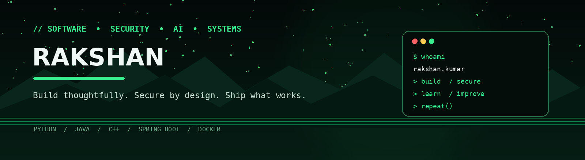

# Hey, I’m Rakshan Kumar 👋

**Information Technology Student | Software Development | Cybersecurity & AI**

I build practical software across full-stack development, backend systems, security, machine learning, and embedded projects. I enjoy understanding how systems work end-to-end—from implementation and testing to deployment.

## 🧰 Tech Stack

- **Languages:** Python, Java, C/C++, JavaScript, SQL
- **Web & Backend:** React, Node.js, Express.js, Spring Boot, Flask
- **Databases:** PostgreSQL, MySQL, MongoDB
- **Tools & Infrastructure:** Git, Docker, Linux, Nginx, Postman
- **Interests:** Application security, cryptography, machine learning, embedded AI

## 🚀 Featured Projects

- **Private Share** — peer-to-peer file sharing with encrypted transfers.
- **StreamVault** — self-hosted media platform with a Spring Boot backend.
- **VoiceBit** — TinyML voice-recognition experiments on ESP32.
- **RentNRead** — full-stack application built with the MERN stack.
- **ML Projects** — predictive modelling and explainable-AI experiments.

## 🤝 Connect

## 🤝 Connect with Me

  
  
  

*Focused on building, learning, and improving through real projects.*
