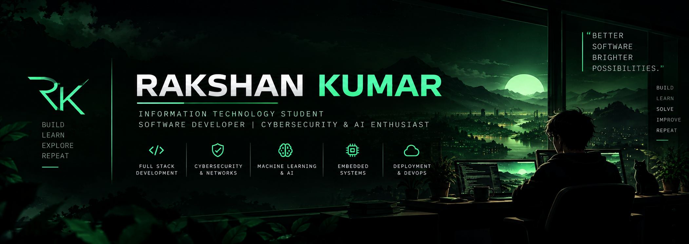

# Hi, I'm Rakshan Kumar 👋

**3rd-year B.Tech Information Technology @ MIT Manipal · Full-stack & security-focused developer**

I build and ship complete products: end-to-end encrypted communication over WebRTC, full-stack platforms with background jobs and delivery tracking, and the self-hosted infrastructure they run on (Docker, Google Cloud, Cloudflare Tunnel).

**Open to software engineering and security internships.** Reach me at [rakshankaveri@gmail.com](mailto:rakshankaveri@gmail.com).

## ⭐ Featured projects

### 🔐 [Private Share](https://github.com/Rakshan-kaveri/private-share) · [Live demo ↗](https://share.rakzu.xyz)

End-to-end encrypted voice/video calls, screen sharing with audio, and file transfer (up to 1 GB) between two browsers. The server only signs people in and relays signalling; media and files travel device to device.

- **Cryptography:** per-browser ECDSA P-256 identity keys (non-extractable), fresh ECDH P-256 + HKDF per call, AES-256-GCM per file with per-chunk authentication and a signed SHA-256 manifest, 12-digit safety code to detect MITM
- **Engineering:** zero runtime dependencies on the server, 27 end-to-end Playwright tests across desktop and phone browsers, hardened Docker container + coturn TURN relay with time-limited HMAC credentials
- **Deployment:** self-hosted on a Google Cloud VM behind Cloudflare Tunnel

`JavaScript` `Node.js` `WebRTC` `Web Crypto API` `WebSockets` `Docker` `Playwright`

### 🌦️ [SkyCast](https://github.com/Rakshan-kaveri/weather) · [Live demo ↗](https://weather.rakzu.xyz)

Live weather maps, alerts and daily reports by email and SMS.

Full-stack weather platform: interactive map with 8 live layers (satellite, radar, wind, cyclone tracks), personal forecasts, weather alerts, and scheduled daily reports by **email and SMS in English, Kannada and Hindi**, including an SMS-only farmer mode for rural users.

- Background worker (node-cron) for scheduled reports, hourly alert rules and 30-minute severe-weather checks (IMD rainfall thresholds, live GDACS cyclone feed)
- Signed delivery webhooks (Resend, SMS gateway) track delivered / opened / bounced for every report
- Admin control room: users, last sign-in location, subscription and delivery status, one-click resend
- Google OAuth sign-in, installable PWA with offline forecast

`TypeScript` `Next.js 15` `React 19` `PostgreSQL` `Prisma` `NextAuth` `Leaflet` `Tailwind CSS`

## 📂 More on GitHub

| Project | What it is | Stack |
| --- | --- | --- |
| [StreamVault](https://github.com/Rakshan-kaveri/StreamVault) | Self-hosted, Netflix-style streaming platform: JWT auth with refresh-token rotation, async FFmpeg processing, HTTP Range streaming and resumable downloads | Java 21, Spring Boot, PostgreSQL, React, TypeScript, FFmpeg, Docker, Nginx |
| [Hotel Management System](https://github.com/Rakshan-kaveri/Hotel-Management-System) | Desktop app for rooms, bookings, services and checkout, backed by MySQL | Java, JavaFX, JDBC, MySQL, Maven |

## 🧰 Tech stack

- **Languages:** JavaScript, TypeScript, Java, Python, C/C++, SQL
- **Web:** React, Next.js, Node.js, Express, Tailwind CSS, WebRTC, WebSockets
- **Data:** PostgreSQL, MySQL, Prisma
- **Security:** Web Crypto API (ECDH, ECDSA, AES-GCM, HKDF), OAuth 2.0, TURN/STUN
- **Infra & tools:** Docker, Linux, Nginx, Google Cloud, Cloudflare Tunnel, Git, Playwright, Postman

## 🤝 Connect

  
  
  

